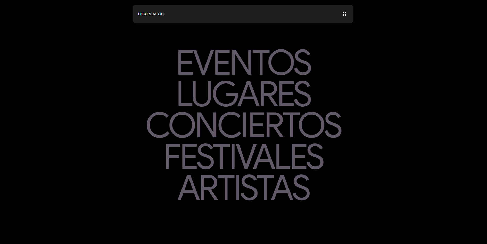
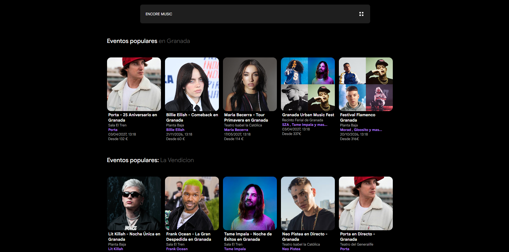
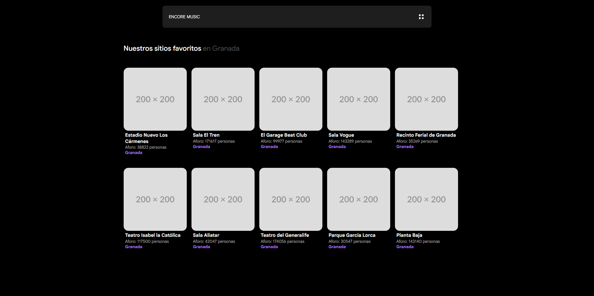
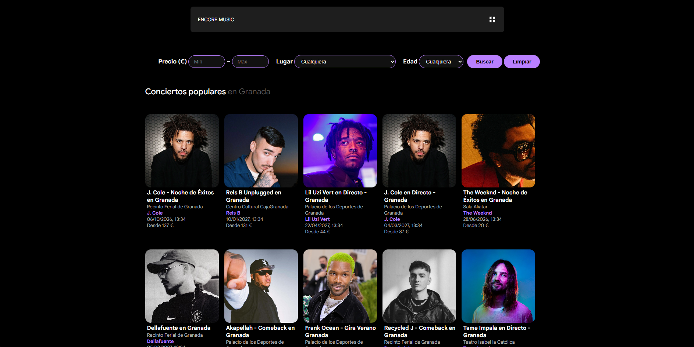
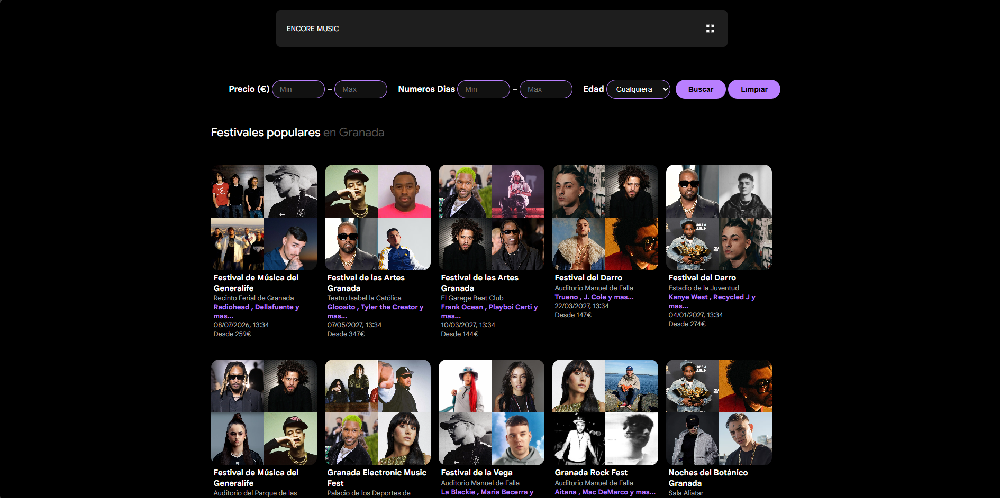
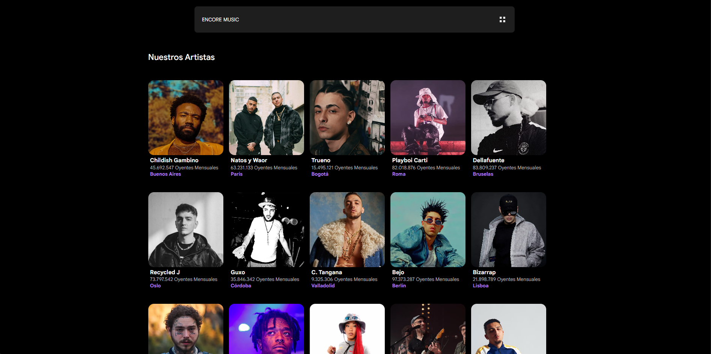
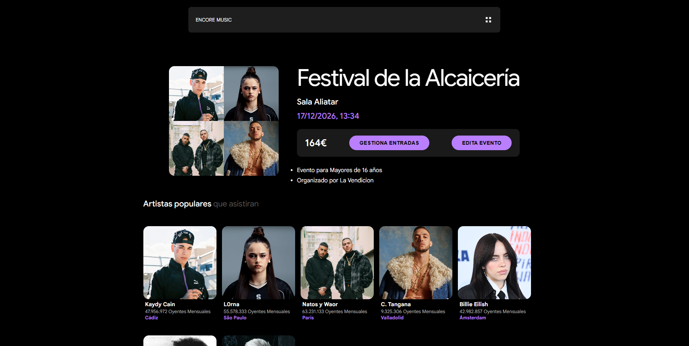

# 🎵 Encore — Gestión de Eventos Musicales

> *"Una app para los que saben que la fila para entrar a un concierto es lo peor del mundo, pero lo harían mil veces más"*

---
Encore es una aplicación para gestionar eventos musicales. Conciertos, festivales, artistas, recintos, asistentes y sus entradas. Todo en un sitio. Sin post-its. Sin Excel. Sin llorar. 

---

## ¿Cómo funciona esto?

El backend es **Spring Boot** (Java) y el frontend es **JavaScript vanilla**. Hablan entre ellos por una API REST. Nada del otro mundo, pero funciona como un reloj.

La parte más interesante del modelo de datos es que `Concierto` y `Festival` heredan de `Evento`. Esto significa que comparten lo básico (nombre, lugar, asistentes, promotor) pero cada uno tiene su propia personalidad:

- Un **concierto** tiene un solo artista, duración y edad mínima.
- Un **festival** tiene una lista de artistas, varios escenarios y puede durar días.

Suena obvio, pero modelarlo bien con JPA requirió sus decisiones.

## 📋 Consola-H2
- Nombre : sa
- Contraseña : (Sin contraseña)

---

### 📋 Requisitos del sistema

- Java 21
- Maven 3.8+
- Navegador web moderno (Chrome, Firefox, Edge)
- No requiere instalación de base de datos (usa H2 en memoria)

---

## 🌐 Rutas del Frontend

| Página | Descripción |
|--------|-------------|
| `http://localhost:8080/index.html` | Página de inicio |
| `http://localhost:8080/eventos.html` | Listado de eventos |
| `http://localhost:8080/conciertos.html` | Listado de conciertos con filtros |
| `http://localhost:8080/festivales.html` | Listado de festivales con filtros |
| `http://localhost:8080/artisas.html` | Listado de artistas |
| `http://localhost:8080/lugares.html` | Listado de lugares |
| `http://localhost:8080/entradas.html` | Generador de entradas con QR |

---

## 📡 Rutas de la API REST

Base URL: `http://localhost:8080/api/v1`

### 🎤 Artistas — `/api/v1/artistas`

| Método | Ruta | Descripción |
|--------|------|-------------|
| GET | `/api/v1/artistas` | Lista todos los artistas |
| GET | `/api/v1/artistas/{id}` | Detalle de un artista |
| GET | `/api/v1/artistas/nombre?nombre={nombre}` | Buscar por nombre |
| GET | `/api/v1/artistas/ciudad?ciudad={ciudad}` | Buscar por ciudad de nacimiento |
| PUT | `/api/v1/artistas/{id}` | Actualizar un artista |
| DELETE | `/api/v1/artistas/{id}` | Eliminar un artista |

### 📍 Lugares — `/api/v1/lugares`

| Método | Ruta | Descripción |
|--------|------|-------------|
| GET | `/api/v1/lugares` | Lista todos los lugares |
| GET | `/api/v1/lugares/{id}` | Detalle de un lugar |
| GET | `/api/v1/lugares/{id}/eventos` | Eventos de un lugar |
| GET | `/api/v1/lugares/nombre?nombre={nombre}` | Buscar por nombre |
| POST | `/api/v1/lugares` | Crear un nuevo lugar |
| PUT | `/api/v1/lugares/{id}` | Actualizar un lugar |
| DELETE | `/api/v1/lugares/{id}` | Eliminar un lugar |

### 🎸 Conciertos — `/api/v1/conciertos`

| Método | Ruta | Descripción |
|--------|------|-------------|
| GET | `/api/v1/conciertos` | Lista todos los conciertos |
| GET | `/api/v1/conciertos/{id}` | Detalle de un concierto |
| GET | `/api/v1/conciertos/precios?min={min}&max={max}` | Filtrar por rango de precio |
| GET | `/api/v1/conciertos/edad/{edad}` | Filtrar por edad mínima |
| PUT | `/api/v1/conciertos/{id}` | Actualizar un concierto |
| DELETE | `/api/v1/conciertos/{id}` | Eliminar un concierto |

### 🎪 Festivales — `/api/v1/festivales`

| Método | Ruta | Descripción |
|--------|------|-------------|
| GET | `/api/v1/festivales` | Lista todos los festivales |
| GET | `/api/v1/festivales/{id}` | Detalle de un festival |
| GET | `/api/v1/festivales/precios?min={min}&max={max}` | Filtrar por rango de precio |
| GET | `/api/v1/festivales/edad/{edad}` | Filtrar por edad mínima |
| GET | `/api/v1/festivales/dias?min={min}&max={max}` | Filtrar por número de días |
| PUT | `/api/v1/festivales/{id}` | Actualizar un festival |
| DELETE | `/api/v1/festivales/{id}` | Eliminar un festival |

### 🎟️ Eventos — `/api/v1/eventos`

| Método | Ruta | Descripción |
|--------|------|-------------|
| GET | `/api/v1/eventos` | Lista todos los eventos |
| GET | `/api/v1/eventos/{id}` | Detalle de un evento |
| GET | `/api/v1/eventos/random` | Eventos aleatorios |
| GET | `/api/v1/eventos/promotor/{promotor}` | Filtrar por promotor |
| PUT | `/api/v1/eventos/{id}` | Actualizar un evento |
| DELETE | `/api/v1/eventos/{id}` | Eliminar un evento |

### 👥 Asistentes — `/api/v1/asistentes`

| Método | Ruta | Descripción |
|--------|------|-------------|
| GET | `/api/v1/asistentes` | Lista todos los asistentes |
| GET | `/api/v1/asistentes/{id}` | Detalle de un asistente |
| GET | `/api/v1/asistentes/email?email={email}` | Buscar por email |
| GET | `/api/v1/asistentes/dni?dni={dni}` | Buscar por DNI |
| GET | `/api/v1/asistentes/evento?eventoId={id}` | Asistentes de un evento |
| PUT | `/api/v1/asistentes/{id}` | Actualizar un asistente |
| DELETE | `/api/v1/asistentes/{id}` | Eliminar un asistente |

---

## 🏗️ Arquitectura del proyecto

```
src/
├── main/
│   ├── java/com/PabloJimenez/encore/
│   │   ├── controller/       # Capa de presentación — recibe peticiones HTTP
│   │   ├── service/          # Interfaces de servicio
│   │   │   └── impl/         # Lógica de negocio
│   │   ├── repository/       # Acceso a datos (JPA)
│   │   ├── entity/           # Modelo de dominio
│   │   ├── util/             # DataLoader con Java Faker
│   │   └── config/           # Configuración de inicialización
│   └── resources/
│       ├── application.properties
│       └── static/           # Frontend (HTML, CSS, JS)
│           ├── js/
│           │   ├── api/      # Llamadas fetch a la API
│           │   ├── config/   # URL base
│           │   ├── pages/    # Lógica de cada página
│           │   └── utils/    # Utilidades compartidas
│           └── css/
└── test/
    └── java/com/PabloJimenez/encore/
        └── service/          # Tests unitarios JUnit 5
```

---

## 🗂️ Modelo de datos

El dominio gestiona **6 entidades** con las siguientes relaciones:

- `LugarEvento` → `Evento` **(One-to-Many)**: un lugar alberga muchos eventos
- `Artista` → `Concierto` **(One-to-Many)**: un artista tiene muchos conciertos
- `Festival` ↔ `Artista` **(Many-to-Many)**: tabla intermedia `festival_artista`
- `Evento` ↔ `Asistente` **(Many-to-Many)**: tabla intermedia `asistente_evento`
- `Evento` es una clase abstracta con herencia `JOINED` de la que heredan `Concierto` y `Festival`

Consulta el diagrama UML en la carpeta `/docs` para una representación visual completa.

## 🛠️ Tecnologías utilizadas

| Capa | Tecnología |
|------|-----------|
| Backend | Spring Boot 4.0.6 |
| Base de datos | H2 (en memoria) |
| ORM | Spring Data JPA / Hibernate |
| Datos de prueba | Java Faker 1.0.2 |
| Tests | JUnit 5 |
| Frontend | HTML5, CSS3, JavaScript ES6 (módulos) |
| Build | Maven |
| Java | 21 |

## 🎞️ Imagenes de Encore

*Pagina incial*




*Pagina Eventos*



*Pagina Lugares*



*Pagina Conciertos*



*Pagina Festivales*



*Pagina Artistas*




*Pagina Evento Detalle*

